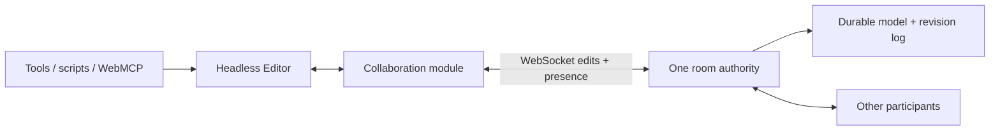

# Collaboration and sharing

Research and proposed plan, October 2, 2026. This is a design proposal, not a
commitment to a backend or sync library. “Field Draw” is assumed to mean tldraw.

The goal: tap **Share**, send a link, and let someone inspect, copy, or edit a
model with you. Local editing and portable files remain the default. Sharing is
an explicit choice that uploads a copy of the document.

## Status

Implemented (October 2026), stages 1–3 below, with live sessions behind a flag:

- **Snapshots.** Share → *Create view link* uploads a gzipped `.voxeltoy` to a `Snapshot`
  Durable Object (`apps/worker/snapshot.ts`). Links look like `#snapshot/<id>/<token>`; opening one
  shows the model view only, with *Make a copy*, *Download* and *Back to my model*. The owner
  key (`voxeltoy-owner:…`; a key that still says `moxel-owner:` is accepted) renews or stops a link and never appears in it.
- **Edit model.** Every document change is a typed op (`packages/core/src/ops.ts`): voxel patches by
  layer id and grid generation, layer add/remove/move/set, palette set/add/remove/replace,
  resize and name. Applying an op checks it first and fills in what it replaced, so the same
  function serves undo, the room and every client. History (`packages/core/src/history.ts`) stores
  ops, keeps selection changes local, and undoes only what someone else hasn't overwritten
  since. Layer ids are random and stable; files still get new ids when opened.
- **Live rooms.** `packages/sync/src/room.ts` is the authority (validate, apply, number, de-duplicate,
  keep recent edits); `packages/sync/src/client.ts` keeps pending edits on top of confirmed state and
  rebases them when others' edits arrive; `apps/worker/room.ts` stores the room in SQLite (layer
  chunks of 32K cells) behind hibernatable WebSockets; `apps/web/src/session.ts` handles links, the
  draft, reconnects and the per-room cache. Start one from Share when `localStorage
  ["voxeltoy:live"] = "1"`, `?live` is in the URL, or in development; anyone can join a link.
- **Kill switch.** `wrangler secret put ROOMS_DISABLED` with `1` turns live sessions off
  without a code change: the Worker refuses new rooms (503) and answers room sockets with a
  closing `disabled` error, so clients end the session with the reason and stop
  reconnecting. Setting the secret ships a new version, which restarts the rooms and ends
  sessions in progress. Share greys out *Start live session* (it asks `GET /api/status`).
  Owners can still rotate and end their rooms, and snapshots are unaffected.
  `wrangler secret delete ROOMS_DISABLED` turns sessions back on. Locally, put
  `ROOMS_DISABLED=1` in `.dev.vars`.
- **Evidence.** `packages/sync/src/sync.test.ts` runs the harness scenarios listed under "Delivery
  order and evidence" plus seeded random runs (four clients editing, undoing, stroking,
  dropping, reconnecting and restarting the room) that must all converge on the room's state.
  Before landing, 4,500 seeds of 800 steps each converged.

Still open: model-space pointer markers and camera following, account-based ownership,
measured limits (the ones in `LIMITS` are provisional), a recovery flow for edits the room
turned down, and comparing Yjs or tldraw sync against this protocol on real documents.

## What to borrow

| Reference | Useful pattern | Voxeltoy adaptation |
| --- | --- | --- |
| Figma sharing | Link access with distinct view and edit permissions | One small Share dialog with separate view and edit links |
| Figma multiplayer | Immediate local feedback; server orders conflicting property edits | Immediate voxel edits, with conflicts resolved per cell |
| tldraw collaboration | Shared rooms, presence, and optional viewport following | A stable room link, participant indicators, then camera following |
| tldraw sync backend | One authoritative room per document, durable storage, WebSockets | Evaluate one Cloudflare Durable Object per shared model |

Figma documents link sharing and view/edit roles in its
[sharing guide](https://help.figma.com/hc/en-us/articles/360040531773-Share-files-and-prototypes).
Its [2019 engineering article](https://www.figma.com/blog/how-figmas-multiplayer-technology-works/)
describes server-ordered property conflicts, optimistic edits, parent-cycle
validation, and multiplayer undo. This is a design reference, not evidence of
Figma Draw's current internal implementation.

tldraw's [collaboration guide](https://tldraw.dev/sdk-features/collaboration)
describes cursors and viewport following. Its
[sync guide](https://tldraw.dev/docs/sync) recommends a self-hosted production
backend with one room per document; the Cloudflare template uses Durable Objects
and SQLite, plus R2 for assets. Authentication, authorization, and some other
production controls still need application code.

Borrow these interaction and architecture ideas. Direct package or source reuse
is a separate decision: tldraw's
[current SDK license guide](https://tldraw.dev/community/license) requires a
production license. Check the exact packages and versions before adopting them.

## First experience

1. From a local model, tap **Share**. Explain that creating a link uploads the model.
2. **Create view link** publishes a fixed snapshot. It stays unchanged as the
   local model changes. Sharing a later version creates another snapshot.
3. The recipient can orbit, zoom, inspect layers, download the model, or tap
   **Make a copy** to edit locally. Opening the link preserves their local draft.
4. Once live rooms ship, **Start live session** creates a shared document from
   the current model and moves the creator into it, preserving the local draft.
5. The room's Share dialog offers **Copy view link** and **Copy edit link**.
   Viewers see subsequent edits; editors can work immediately with a generated
   name and an optional rename field.
6. Show a small participant group and a tappable connection indicator:
   **Connecting**, **Saved**, **Saving**, **Reconnecting**, or **View only**.
   “Saved” means the server has durably accepted all local edits.

Snapshot links and live links must say which kind they are. Snapshot access and
room access should be revocable. The creator can rotate either invitation and
stop sharing; server enforcement also applies to existing connections.

Keep controls in the existing floating UI. At compact widths, use a short Share
sheet and a participant count. All actions use `var(--hit)` and work without
hover or keyboard shortcuts. Camera following is a later tappable action;
orbiting exits follow mode.

For a first version, propose account-free capability links: possession of a view
or edit token grants that permission. A separate owner credential manages access
and deletion. Keep it out of copied invitation links. Without accounts, losing
the owner credential means losing management access; this must be clear before
creation, with a way to save a recovery credential. Accounts and cross-device
ownership can follow if needed.

## Fit with today's editor

The headless `Editor` already groups writes into transactions and cancellable
strokes. Keep that interface as the way tools, scripts, and WebMCP make edits.
Several internals need work before a room can safely share those edits:

- `history.ts` stores undo/redo closures and diffs keyed by `Uint8Array` identity.
  These cannot be transmitted or replayed against another client's arrays.
- Structural changes sometimes restore a captured whole layer list or palette.
  That would overwrite unrelated remote changes.
- Layer IDs use a timestamp and counter; `loadDocument` generates new ones. The
  file format stores parent links by array index. Rooms need stable IDs across
  clients and reconnects, using collision-resistant IDs for newly created layers.
- `documentVersion` is an autosave trigger, not an edit stream. Selection
  transactions and changes to local layer visibility/locks can also trigger it.
- Autosave uses a single `voxeltoy:document` key. On open, a browser that still has
  `moxel:document` (and the other `moxel:` keys) is copied onto the `voxeltoy` names.
  Room caches must use separate keys and never replace that local draft on entry, exit, or unload.
- Some edits mutate full arrays directly, including layer transforms. Palette
  picker previews also bypass transaction recording. Audit all mutation paths.

Keep `.voxeltoy` v1 as the portable format initially. Add a room snapshot format
that retains layer IDs and schema version. File export strips room credentials
and uses the existing layer-index representation. File import creates fresh IDs.
Opening a file from a room opens a local document; replacing everyone's shared
document requires a separate explicit action.

## State ownership

| State | Treatment |
| --- | --- |
| Voxels, model name, size, palette, layer names/order/parents/pivots | Shared and persistent; each accepted edit is undoable |
| Selection, active layer, tool/color, mirror/slice, visibility/lock, camera | Local to each participant |
| Participant name/color, active layer, model-space pointer, optional selection bounds | Ephemeral presence; expires on disconnect |
| Stroke, shape, transform, extrusion, and color-picker previews | Local until committed; optional presence previews later |
| Undo/redo history | Local to the participant; document inverses become new shared edits |
| Invitations, owner credential, access policy | Server-managed metadata outside model files and edit history |

Layer visibility and lock currently travel in files but are UI state under the
agent guide. Use the creator's values as initial defaults, then keep each user's
overrides local. A layer lock is a personal editing aid, not an access permission.

## Proposed sync design

Use a deep collaboration module with a small interface: connect/disconnect,
reactive status and participants, and share/access methods. Connect it to the
Editor through committed document edits and a dedicated remote-apply method.
The transport lives outside the Editor; the Editor remains DOM-free. UI controls
read state and invoke methods rather than sending patches themselves.

The proposed baseline is server-ordered, atomic transactions with sparse cell
patches, not whole-document synchronization. A transaction contains a schema
version, unique operation ID, actor/session ID, base revision, grid generation,
label, and typed edits addressing stable layer IDs. Separate document edits from
selection history. Suppress outgoing events and local history entries when
applying remote edits.

The room validates edits, applies them in order, persists the result, then
acknowledges and broadcasts a canonical revision. Deduplicate retries by operation
ID. Clients keep confirmed state plus unacknowledged local edits and rebase the
local edits after incoming revisions. The same authority must enforce permissions
for UI, scripts, and agents. Reject invalid colors, cells, dimensions, layer
references, and parent cycles before changing state.

Start with committed strokes: dragging updates local geometry immediately;
pointer-up publishes one transaction. A second finger cancels the local stroke
without publishing a reversal. Remote changes must update confirmed state beneath
the local stroke so cancellation cannot restore stale cells over remote work.
Long strokes can show ephemeral presence before they commit. Streaming document
edits during a stroke is a later decision because cancellation gets harder.

### Conflict rules to prove

- Different cells or different layer properties merge. For the same cell or
  property, the last accepted server write wins. This uses server order, not
  device clocks. Send concrete results of fill/mirror/selection tools, not pointer
  events or commands that could compute different results on different clients.
- A voxel patch carries a grid generation. Resize advances it; an old-generation
  patch is rejected and retained for local recovery rather than applied to the
  wrong cell index.
- Layer deletion rejects later edits targeting that deleted ID. Undo of deletion
  restores explicit content and links after validation, rather than restoring
  the old whole layer list.
- Palette add/remove/remap, layer merge, transforms, resize, and reorder need
  explicit structural operations and preconditions. Serialize them against their
  relevant revisions; reject stale destructive changes with an actionable reason.
  Do not treat every structural operation as a last-write-wins array replacement.
- Concurrent palette additions require canonical slot assignment or a stale-
  revision rejection. A voxel edit cannot refer to a slot whose meaning changed.
- If a remote structural edit invalidates a local preview, cancel the preview
  with a short notice. Reconcile selections and active-layer fallback locally.

### Undo and reconnect

Propose participant-local, conditional undo. Each document history entry records
before/after values and the accepted write identities. Undo restores only fields
still owned by that edit; fields overwritten by another edit stay unchanged.
For example, if A paints red and B later paints blue, A's undo leaves blue.
Compare write identity, not just color, so repeated values do not hide conflicts.
Report partial or skipped undo. Redo derives from what undo actually changed.
Structural inverses also need preconditions and must preserve unrelated work.
Local selection undo remains available without network traffic.

For v1, pause new shared edits when disconnected. Preserve the last confirmed
model and pending committed edits in a room-specific local cache, with **Make a
local copy** available. On reconnect, obtain missing revisions or a fresh
snapshot and deduplicate/reconcile pending edits. If access changed or operations
are stale, keep a recoverable local copy. Arbitrary offline editing and merging
are deferred; reconnect must never upload an old whole model over newer work.

## Backend and alternatives

Voxeltoy already deploys static assets to Cloudflare. Evaluate a Worker with one
Durable Object per room, WebSockets, and SQLite persistence. Cloudflare
[recommends SQLite for new Durable Objects](https://developers.cloudflare.com/durable-objects/best-practices/access-durable-objects-storage/).
Its [WebSocket pricing guidance](https://developers.cloudflare.com/durable-objects/platform/pricing/)
recommends hibernation; room/session state must survive waking. Hosting choice
still needs a deployment spike, including the existing `cf`/Wrangler configuration.

| Option | Assessment |
| --- | --- |
| Voxeltoy-specific server-ordered protocol | Proposed baseline; fits packed voxels and server validation, but we own reconciliation and undo |
| tldraw sync/store | Evaluate schema fit and licensing; it is not a drop-in replacement for Solid, typed arrays, and current history |
| Yjs | Compare if offline-first merging becomes a requirement; measure cell granularity and memory before choosing a representation |

Yjs supports [shared arrays, maps, and binary values](https://github.com/yjs/docs/blob/main/getting-started/working-with-shared-types.md).
That alone does not make mutations inside Voxeltoy's existing typed arrays observable.
Replacing one binary layer value would still create a conflict at layer granularity.

Use chunked storage and sparse patches without changing the editor's packed-array
representation. Benchmark 16³ and 32³ chunks before choosing. At the existing
256³ size limit, one raw layer is 16 MiB; dense state plus copies, write identities,
history, and multiple layers can quickly exceed the backend budget. Consult
[platform limits](https://developers.cloudflare.com/durable-objects/platform/limits/)
and set measured room limits. Large transaction parts must stage before one atomic
commit; never reveal half a fill or transform. Defer R2 until snapshot size or
reference assets justify it.

Apply access checks to snapshot reads and every write. Exchange invitation tokens
for scoped sessions, keep secrets out of logs, and rate/size-limit room creation,
connections, presence, and operations. Store token hashes; rotate/revoke sessions
when permissions change. Define retention and deletion before public launch.

## Delivery order and evidence

1. **Share snapshots.** Build creation, view/copy/download, owner recovery,
   revocation, and draft isolation. Verify phone and desktop workflows, malformed
   uploads, denied access, and storage durability. This ships independently.
2. **Prove the edit model.** Add serializable edits and stable room IDs. Use a
   deterministic headless multi-client harness to compare the proposed protocol
   with alternatives. Prove remote/local history separation, conditional undo,
   stroke cancellation, and structural conflicts before choosing the sync engine.
3. **Live rooms behind a development flag.** Add durable commits, optimistic
   reconciliation, reconnect, view/edit roles, and basic presence. Exercise every
   current document operation through Editor and WebMCP. Any unsupported operation
   must be blocked explicitly in a room; it must never silently diverge.
4. **Public collaboration.** Complete structural-operation coverage, access
   rotation, recovery, limits, and phone testing. Add model-space pointer markers
   and optional camera following after sync correctness is established.

The harness must cover simultaneous same/different-cell edits, duplicates and
lost acknowledgments, remote edits during cancelled strokes, undo/redo after
remote overwrite, delete/edit races, palette remaps, resize races, parent cycles,
restart/hibernation, access revocation, and schema mismatch. All clients must
converge to the durable server revision after pending edits settle. Measure join
time, stroke visibility delay, patch size, memory, meshing cost, and persistence
cost on realistic and near-limit documents.

The next implementation task should be snapshot sharing plus a bounded sync
experiment. Decisions still open: account-free owner recovery versus accounts,
snapshot/room retention, measured size and participant limits, and whether remote
stroke visibility needs to update before pointer-up. Comments, chat, teams,
version browsing, and general offline merging can follow later.
